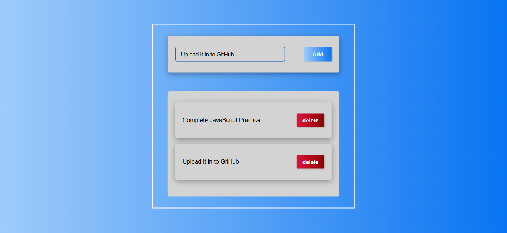
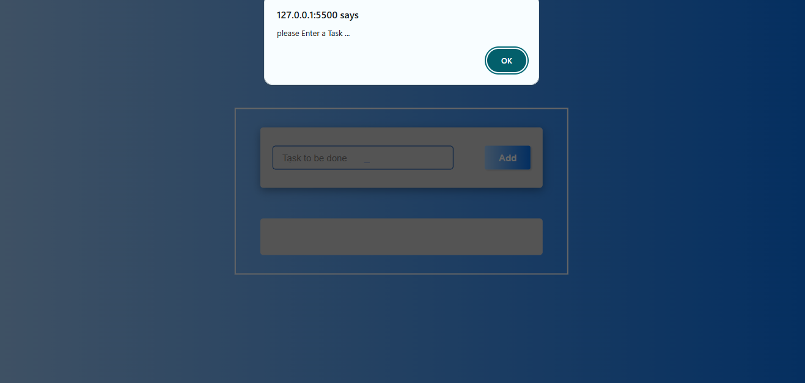

# 📝 To-Do List – Task Management App

A simple and responsive To-Do List application built using HTML, CSS, and JavaScript. It allows users to add tasks, view their task list, and delete individual tasks through an interactive interface.

## 🌐 Live Demo

[](https://inthusha20241647-commits.github.io/To-Do-List/)

## 📸 Screenshots

📸 Screenshots

🖥️ Desktop View

<p align="center">
  
</p>

📱 Mobile View

<p align="center">
  
</p>

## ✨ Features

- ➕ **Add Tasks:** Allows users to add new tasks to the list.
- ⚠️ **Input Validation:** Displays an alert when users try to add an empty task.
- 🗑️ **Delete Tasks:** Allows users to remove individual tasks.
- 📋 **Dynamic Task Display:** Displays newly added tasks dynamically using JavaScript.
- 📱 **Responsive Design:** Adapts the layout for smaller mobile screens.
- 🎨 **Gradient Background:** Uses a blue gradient background for visual presentation.

## 🛠️ Technologies Used

- HTML5
- CSS3
- JavaScript
- CSS Flexbox
- CSS Media Queries

## 📂 Project Structure

```text
To-Do-List/
│
├── images/
│   ├── desktop.png
│   └── mobile.png
│
├── index.html
├── style.css
├── script.js
└── README.md
```

## 🚀 How to Run Locally

1. Clone the repository:

   ```bash
   git clone https://github.com/inthusha20241647-commits/To-Do-List.git
   ```

2. Open the project folder in VS Code.
3. Open `index.html` in your browser or use the Live Server extension.

## 🎯 Learning Objectives

- Understand HTML structure and form input elements.
- Practise CSS styling and Flexbox layouts.
- Learn JavaScript DOM manipulation.
- Handle click events using event listeners and event handlers.
- Dynamically create and remove HTML elements.
- Implement basic input validation.
- Practise responsive web design using CSS media queries.

---

*This project is part of my continuous learning journey in frontend web development.*
